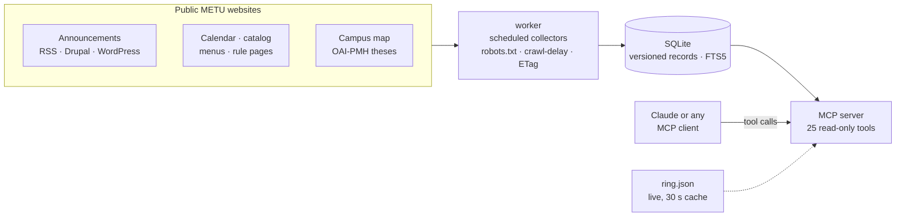

<p align="center">
  
</p>

<p align="center">
  <a href="https://github.com/izzetemredemir/metu-mcp/actions/workflows/ci.yml"></a>
  <a href="LICENSE"></a>
  
  
  <a href="https://modelcontextprotocol.io"></a>
  
</p>

<p align="center">
  <b>25 tools</b> · <b>54</b> announcement feeds · <b>91</b> tracked info pages · <b>72</b> official links<br>
  <sub>Every answer names its official source and says when it was last checked.</sub>
</p>

---

**metu-mcp** is a [Model Context Protocol](https://modelcontextprotocol.io) server that lets METU (ODTÜ, Middle East
Technical University) students ask an AI assistant about university life — announcements, the academic calendar, the
cafeteria menu, courses and prerequisites, where they may park, ring buses, the campus map and more. It answers in
**Turkish and English**, like METU itself.

> [!IMPORTANT]
> **Unofficial.** A student project, not run, endorsed or supported by METU. Answers come from METU's public web pages
> and may be out of date: always check the official link each answer cites.

## Ask it anything

| You ask | Answered by |
|---|---|
| *Bugün yemekhanede ne var?* | `metu_dining_menu` |
| *Ekle-sil ne zaman bitiyor?* | `metu_calendar_events` |
| *CENG 213'ün önkoşulu ne?* | `metu_course_info` |
| *Kahverengi pulum var, akşam 7'de MM önüne park edebilir miyim?* | `metu_parking_check` |
| *Sarı ring saat kaçta kalkıyor?* | `metu_transport` |
| *Mediko'da bugün göz doktoru var mı?* | `metu_doctors_on_duty` |
| *I passed MATH 119 and CENG 140 — which courses open up?* | `metu_course_eligibility` |
| *How do I connect to eduroam on my iPhone?* | `metu_it_help` |
| *What changed at METU this week?* | `metu_recent_changes` |

### What an answer looks like

Real output, trimmed, for *"Kahverengi pulum var, salı akşam 7'de MM önüne park edebilir miyim?"*:

```text
Öğrenci kahverengi taşıt pulu ile "Faculty of Engineering" çevresi (Salı 19:00, İstanbul saati):
• Engineering Sciences Parking Lot-2 (14 m): yalnızca mesai dışında → şu an uygun
• Engineering Sciences Parking Lot (34 m): yalnızca mesai dışında → şu an uygun
• Cafeteria Parking Lot (75 m): izin yok
…
Resmi kural: "… Bu sürücüler mesai saatleri dışında (18:00-07:00 saatleri arasında), hafta sonları ve sömestr
tatillerinde bölüm park yerlerini kullanabilirler."
Yerindeki tabelalar ve görevli uyarıları her zaman bu özetten önce gelir.

— Kaynak: ihm.metu.edu.tr · son kontrol 2026-10-18 07:00 (İstanbul saati) · sayfanın güncellenme tarihi 2026-07-11
— Kaynak: map.metu.edu.tr · son kontrol 2026-10-04 21:07 (İstanbul saati)
```

Every answer ends like this: the official source, when it was last checked, and the page's own "last updated" date.
Stale or failing sources add an explicit ⚠️ warning ([docs/freshness.md](docs/freshness.md)).

## What's inside

| | |
|---|---|
| 📢 **News** | Announcements from the main site, the Registrar (ÖİDB), 35 departments and language units, graduate schools, Erasmus, IT, dorms, library, sports, health center, cafeteria, Career Center, the *Bu Hafta* bulletin and the Alumni Office — plus "what changed" tracking |
| 📅 **Academic calendar** | Search ("finaller ne zaman?"), upcoming deadlines, `.ics` export, moved-date detection |
| 🎓 **Courses & study** | Course catalog (credits, ECTS, prerequisites in both directions, syllabus outcomes), curricula incl. double major and minor, prerequisite eligibility, unofficial degree audit, GPA calculator with the regulation's scale, OpenMETU theses, METULearn trainings |
| 🍽️ **Daily life** | Cafeteria menu a week ahead, doctors on duty, sports facilities and pools, library rules, clubs and events, dorm fees, IT help (eduroam, VPN, e-mail) |
| 🗺️ **Getting around** | ~540 campus places and classroom codes, A → B routes with the right ring, live ring arrivals, "can I park here?", vehicle permits |
| 🔗 **The rest** | A curated catalog of official links that says when a METU login is needed (grades, transcript, fees, personal exam schedule) |

## How it works



- **Collectors write, tools read.** A scheduled worker is the only writer; tool calls only read the database (the live
  ring feed is the one exception, cached for 30 s).
- **Versioned records.** Every page and announcement keeps its history, so the server can say what changed and when.
- **No made-up answers.** When data needs a login or is not collected, the answer points to the right official page.
- **Scraped text is data, not instructions.** Hidden elements and control characters are stripped before storage.

## Quick start

Requires **Node.js 24.21.0** (`nvm use`) and pnpm.

```bash
pnpm install
pnpm refresh                 # collect all sources once (takes several minutes: crawl-delay is respected)
pnpm serve                   # HTTP endpoint on http://127.0.0.1:8787/mcp
pnpm dev serve --stdio       # or stdio for local clients
pnpm worker                  # scheduled collection (production)
pnpm test                    # parser + tool tests against recorded fixtures, no network
```

### Connect a client

```bash
# Claude Code, local
claude mcp add metu -- npx tsx /path/to/metu-mcp/src/cli.ts serve --stdio
# Claude Code, remote
claude mcp add --transport http metu https://mcp.example.edu.tr/mcp
# MCP Inspector
pnpm inspector
```

- **Claude Desktop:** `pnpm mcpb` builds a one-click bundle; see [docs/local.md](docs/local.md).
- **Claude (web/desktop) connectors:** Settings → Connectors → Add custom connector → `https://<your-host>/mcp`.
- **On a Mac:** `pnpm local:install` runs the worker as a launchd agent ([docs/local.md](docs/local.md)).
- **On a server:** systemd + Caddy on Ubuntu ([docs/deploy.md](docs/deploy.md)); configuration in [.env.example](.env.example).

<details>
<summary><b>All 25 tools, resources and prompts</b></summary>

| Tool | What it answers |
|---|---|
| `metu_today` | One call for today: menu, academic-calendar entries, campus events, doctors on duty, recent Registrar and department news |
| `metu_search` | One-shot search over everything (announcements, rule pages, calendars, official links); retries misspelled queries ("kütüpane") |
| `metu_find_link` | "Where do I …?" — official page, and whether it needs a METU login |
| `metu_announcements` | Announcements from the main site, Registrar (ÖİDB), 35 departments and language units, graduate schools and institutes, Erasmus, BİDB, IHM, dorms, library, sports, pools, health center, cafeteria notices, Career Center job/internship postings, the *Bu Hafta* bulletin and the Alumni Office |
| `metu_calendar_events` | Academic calendar search ("ekle-sil ne zaman?", finals, holidays, tuition) |
| `metu_calendar_next` | Upcoming deadlines |
| `metu_course_info` | Course catalog: credits, ECTS, prerequisites (and what a course is a prerequisite for), content — by code, department or keywords |
| `metu_campus_services` | Sports facilities and pools, health center (doctors on duty, counselling), library hours and rules, student clubs and events, security contacts, accessibility office, regulations (probation, double major, resits, summer school), School of Foreign Languages courses (TOEFL/IELTS/General English fees and term dates, placement exam, TOEFL iBT centre), dormitories (monthly fee of every room type from the official fee spreadsheet, payment accounts, placement points, regulation), Registrar FAQ and forms, scholarships, International Students Office (residence permit, insurance, tuition, cost of living) |
| `metu_doctors_on_duty` | Which doctors are at the health center (Medico) today, by specialty |
| `metu_events` | Upcoming student club events, university events (talks, fairs, festivals) and the Culture and Convention Center (KKM) calendar |
| `metu_theses` | Master's and PhD theses from OpenMETU: search titles/abstracts, filter by department, advisor, author, degree, year; record and PDF links |
| `metu_it_help` | BİDB IT FAQ: Wi-Fi/eduroam, VPN, e-mail, passwords, licensed software, smart card |
| `metu_trainings` | METULearn catalog (~560 trainings): ODTÜ-SEM certificate programmes, Bilgeİş and METU OCW courses — format, price, start date, registration status, enrolment link |
| `metu_program_curriculum` | Semester-by-semester undergraduate curriculum of a department: must courses, elective slots, "choose one of" groups, ECTS totals; also its double major and minor programmes |
| `metu_course_eligibility` | From the courses passed: which courses' prerequisites are now met, and which miss one |
| `metu_degree_audit` | Unofficial progress check against the curriculum: missing must courses, open choice groups, elective slots, ECTS |
| `metu_gpa_calculator` | Term and cumulative GPA from letter grades, with the regulation's scale, repeat rule, honor ranges and probation line (collected, not hard-coded) |
| `metu_campus_route` | Getting from A to B on campus: distance, walking time, nearest ring stops, which ring to take (from the official route tables), walking-route link (classroom codes work too) |
| `metu_recent_changes` | What changed: new announcements, moved calendar dates, edited rule pages |
| `metu_status` | How fresh the data is per source family, and which sources are failing |
| `metu_dining_menu` | Cafeteria menu (today … +7 days), meal hours, student price |
| `metu_campus_place` | Buildings, lots, gates, ATMs … with coordinates (understands "MM", "KKM", "BÖTE", "çarşı", and Turkish names from OpenStreetMap such as "Mediko", "Üçlü Amfi") and classroom codes ("BMB G102", "U2"); building outlines from OpenStreetMap |
| `metu_parking_check` | "Can I park here?" for a permit type and time, with the official rule text |
| `metu_vehicle_permit` | Student vehicle permits: types, eligibility, documents, where to apply |
| `metu_transport` | Live ring bus arrivals and ring timetables |

**Resources:** `metu://links`, `metu://parking/rules`, `metu://status`, `metu://calendar/{year}/{lang}.ics`,
`metu://course/{code}` (with code completion).
**Prompts:** `weekly_summary`, `semester_start_checklist`, `course_planning` (department completes from the catalog),
`exam_week`.

Every tool takes `lang: "tr" | "en"` (default `tr`). See [docs/mcp-design.md](docs/mcp-design.md).

</details>

## A good citizen on METU's servers

- **Public pages only.** Login-protected systems (OİBS, ODTÜClass, METU Mail …) are never scraped and the server never
  asks for credentials.
- **robots.txt is always obeyed.** Hosts that disallow crawling (oibs2, SIS, the library catalog) and sites that bar AI
  agents are link-only. If robots.txt cannot be read, nothing on that host is fetched.
- **Gentle by design.** Scheduled, never on demand; one request per host at a time, at least 3 s apart or the site's
  crawl-delay; conditional requests (ETag / Last-Modified); backoff on errors. Well under 200 requests an hour in total.
- **No personal data.** The User-Agent names the project only; grades and course lists passed to the GPA and planning
  tools are never stored.

Details: [docs/scraping-policy.md](docs/scraping-policy.md).

## Development

```bash
pnpm typecheck && pnpm test  # 190+ tests against recorded pages, no network
```

New sources go into `src/config.ts`: public `*.metu.edu.tr` pages that robots.txt allows, each with a recorded fixture
in `tests/fixtures/` and a parser test. Fixtures must not contain personal notices or student names.

| Docs | |
|---|---|
| [services-catalog.md](docs/services-catalog.md) | METU web services, formats and how each is (or is not) used |
| [mcp-design.md](docs/mcp-design.md) | Tool design, bilingual behaviour, output format |
| [freshness.md](docs/freshness.md) | How data currency is tracked and shown |
| [scraping-policy.md](docs/scraping-policy.md) | Politeness, robots.txt, security |
| [links.md](docs/links.md) | Generated list of the official link catalog |
| [local.md](docs/local.md) · [deploy.md](docs/deploy.md) | Running on a Mac · on a VPS |
| [roadmap.md](docs/roadmap.md) | What's next |

## License

Code: MIT ([LICENSE](LICENSE)). `tests/fixtures/` holds copies of public METU web pages recorded for parser tests; their
content belongs to METU. OpenStreetMap data © OpenStreetMap contributors (ODbL). METU and ODTÜ are names of Middle East
Technical University, which has no part in this project.
